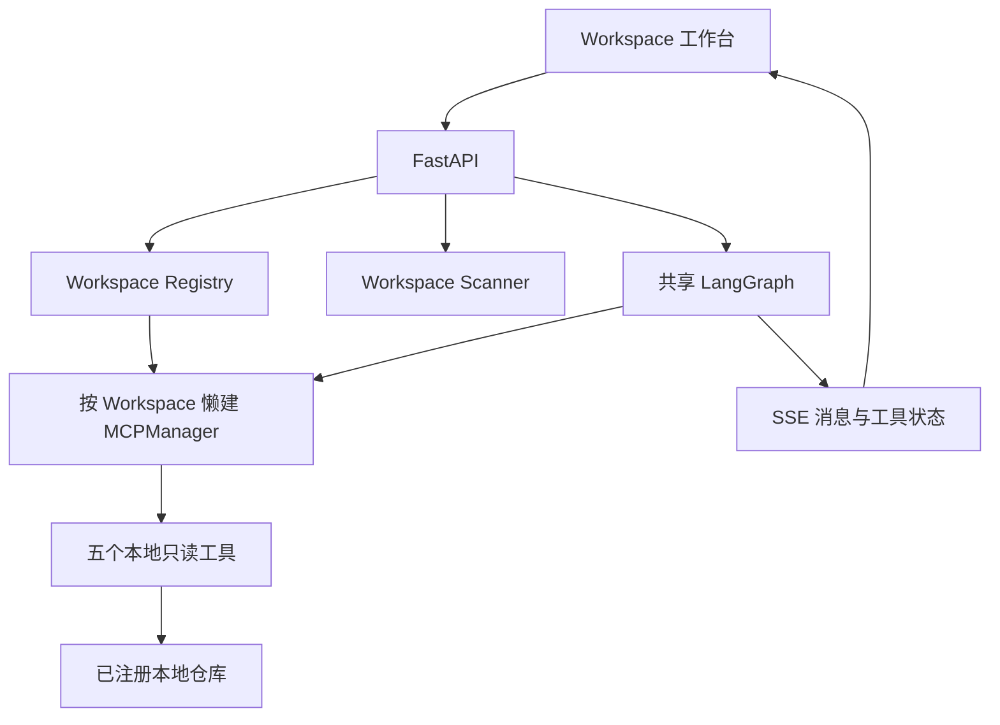

<!-- 作者：lxy -->

# AI 研发助手（Dev Copilot）

> 基于 LangGraph + FastAPI 的研发助手引擎，可在本地 Workspace 中注册多个仓库并进行只读代码问答。

---

## 当前已验证能力

- **本地 Workspace** — 创建、列出、查询、激活和删除本机注册元数据
- **多仓库注册与扫描** — 识别语言、构建系统、服务、中间件、显式依赖和 Git 信息
- **Workspace 隔离工具** — 每个 Workspace 独立提供 `list_dir`、`find_files`、`grep_code`、`read_file`、`code_search` 五个只读工具
- **Graph 工具闭环** — 模型可在一次会话中读取多个已注册仓库，再结合工具结果回答
- **SSE 流式输出** — 逐 token 推送回答，并报告工具开始、完成或失败状态
- **薄工作台** — 单页完成 Workspace 切换、仓库注册、扫描与只读聊天

---

## 架构图



---

## 技术栈

| 层级 | 技术选型 |
|------|----------|
| **Python 引擎** | FastAPI 0.115+ · LangGraph 0.2+ · LangChain-OpenAI · Redis (aioredis) · httpx · Pydantic 2 · FAISS · Loguru |
| **Java 数据服务** | Spring Boot 3.2 · MyBatis-Plus 3.5 · Redis Stream Consumer Group · MySQL 8.0 |
| **基础设施** | Docker Compose · Redis 7 (AOF) · MySQL 8 · SSE · MCP Protocol |
| **LLM** | DeepSeek-Chat (L1 路由/轻量) · DeepSeek-Reasoner (L2 复杂推理) · OpenAI 兼容协议 |

---

## 快速启动

```bash
# 1. 克隆仓库 & 配置环境变量
git clone <repo-url> && cd agent
cp .env.example .env
# 编辑 .env，填入 LLM_API_KEY（DeepSeek / OpenAI 兼容 key）

# 2. 一键启动（Redis + MySQL + Python 引擎 + Java 服务）
docker compose up -d --build

# 3. 访问
# 前端聊天界面：http://localhost:8000
# API 文档：    http://localhost:8000/docs
# Java 数据服务：http://localhost:8081
# 健康检查：    curl http://localhost:8000/health
```

> 本地开发快捷命令：`cd engine && pip install -e . && python -m engine.main`（需本地 Redis）

---

## 本地 Workspace 使用

启动引擎后打开 `http://localhost:8000`：

1. 输入 Workspace ID 和名称，点击“新建并激活”。
2. 输入仓库名称与本地绝对路径，点击“添加仓库”；可重复添加多个仓库。
3. 点击“扫描当前 Workspace”，查看每个仓库的语言、构建系统、服务和中间件摘要。
4. 在聊天区提问，例如“读取 `order-service` 和 `platform` 的配置，总结重试次数”。聊天和工具请求会绑定当前 Workspace，只能读取其中已注册仓库。

同一流程也可通过 API 完成：

```bash
curl -X POST http://localhost:8000/workspaces \
  -H "Content-Type: application/json" \
  -d '{"id":"local-dev","name":"Local Dev"}'

curl -X POST http://localhost:8000/workspaces/local-dev/repositories \
  -H "Content-Type: application/json" \
  -d '{"name":"order-service","local_path":"/absolute/path/order-service"}'

curl -X POST http://localhost:8000/workspaces/local-dev/scan
curl -X POST http://localhost:8000/workspaces/local-dev/activate
```

`GET /tools?workspace_id=local-dev` 可查看该 Workspace 的五个只读工具 schema。`POST /chat` 的请求体使用相同的 `workspace_id`，并通过 SSE 返回回答与工具状态。

---

## 开发者模式（中间件 Docker + 代码本地跑）

### 适用场景

日常开发、调试、频繁改代码时推荐此模式：
- 代码改完秒生效（`--reload` 热重载）
- 支持 IDE 断点调试（attach 本地进程）
- 无需每次重新 build 镜像，迭代效率高

### 前置要求

| 依赖 | 版本 | 说明 |
|------|------|------|
| Python | ≥ 3.10（推荐 3.11） | Agent 引擎运行时 |
| Docker & Compose | 最新稳定版 | 仅用于中间件容器 |
| Java 17 | 可选 | 仅 Java 数据服务需要 |

### 步骤

#### 1. 只起中间件

```bash
docker compose up -d redis mysql
```

> 仅启动 Redis 和 MySQL 容器，Python/Java 服务在本地运行。

#### 2. Python 引擎本地启动

```bash
cd engine
python3.11 -m venv .venv && source .venv/bin/activate
pip install -e .
cd ..  # 回到 agent/ 根目录
uvicorn engine.main:app --reload --host 0.0.0.0 --port 8000
```

- `--reload`：文件变更自动重启，开发必备
- 确保 `.env` 中 `REDIS_URL` 指向 `redis://localhost:6379/0`

#### 3. Java 服务本地启动（可选）

```bash
cd java-service
mvn spring-boot:run
```

> 仅在需要数据持久化功能时启动，默认端口 8081。

#### 4. 访问

- 前端聊天界面：http://localhost:8000
- API 文档：http://localhost:8000/docs
- 健康检查：`curl http://localhost:8000/health`

### 两种模式对比

| 维度 | 全 Docker（方案 A） | 开发者模式（方案 B） |
|------|---------------------|----------------------|
| **启动方式** | `docker compose up -d --build` 一键全起 | 中间件容器 + 本地进程分开启动 |
| **代码生效** | 需重新 build 镜像（~30s） | 秒级热重载（`--reload`） |
| **调试支持** | 需额外配置 remote debug | 原生 IDE 断点调试 |
| **环境一致性** | 接近生产环境，适合联调验收 | 依赖本地 Python/Java 版本 |
| **资源占用** | 较高（所有服务容器化） | 较低（仅中间件容器化） |

### 切换提示

两种模式可随时切换：

```bash
# 停掉全部容器（从全 Docker 切到开发者模式）
docker compose down

# 只保留中间件（开发者模式）
docker compose up -d redis mysql

# 恢复全 Docker 模式
docker compose up -d --build
```

---

## 项目结构

```
agent/
├── docker-compose.yml           # 多服务编排（Redis/MySQL/Engine/Java）
├── .env.example                 # 环境变量模板
├── engine/                      # Python Agent 引擎（核心）
│   ├── main.py                  # FastAPI 入口 + lifespan 初始化
│   ├── config/settings.py       # Pydantic Settings 配置管理
│   ├── infra/                   # 基础设施（redis_client / llm_client / dynamic_config）
│   ├── core/
│   │   ├── dispatcher/          # 智能路由（Flash LLM + 超时降级）
│   │   ├── scheduler/           # CAS 抢占锁 + 任务队列
│   │   ├── memory/              # ZSET 记忆 + 三层截断格式化
│   │   ├── mcp/                 # MCP 三层容错 + 混合工具源
│   │   ├── orchestrator/        # Supervisor + Planner + SubAgentTool
│   │   ├── openspec/            # OpenSpec 模块
│   │   ├── hitl/                # 审批模块
│   │   ├── rag/                 # 检索模块
│   │   └── streaming/           # SSE 流式引擎
│   ├── orchestrator/            # LangGraph 编排（graph_builder / nodes）
│   ├── api/                     # REST 路由（chat / tasks / tools）
│   └── tests/                   # 单元测试
└── java-service/                # Java 持久化服务（Spring Boot + MyBatis-Plus）
```

---

## 环境变量说明

| 变量 | 说明 | 默认值 |
|------|------|--------|
| `LLM_API_KEY` | LLM 服务 API Key（必填） | — |
| `LLM_BASE_URL` | OpenAI 兼容 API 地址 | `https://api.deepseek.com/v1` |
| `LLM_MODEL` | L1 轻量模型 | `deepseek-chat` |
| `LLM_MODEL_L2` | L2 复杂推理模型（留空复用 L1） | — |
| `REDIS_URL` | Redis 连接地址 | `redis://localhost:6379/0` |
| `WORKSPACE_DIR` | Agent 文件操作沙箱目录 | `./workspace` |
| `CONFIG_REFRESH_INTERVAL` | 动态配置轮询间隔(秒) | `30` |

---

## 核心设计理念

1. **Workspace 隔离** — 本地工具固定绑定一个 Workspace，只解析其中已注册仓库的虚拟路径
2. **只读优先** — 当前工具 schema 仅包含目录浏览、文件查找、代码搜索和文件读取
3. **请求级依赖** — Chat 与 Tools 按请求解析显式或 active Workspace，并向共享 Graph 传入对应 manager
4. **确定性扫描** — 扫描结果来自支持的项目清单和 Git 元数据，按稳定顺序返回

---

## License

MIT

---

> 作者：lxy ｜ 技术栈：Python + Java 双栈 ｜ 编排引擎：LangGraph
